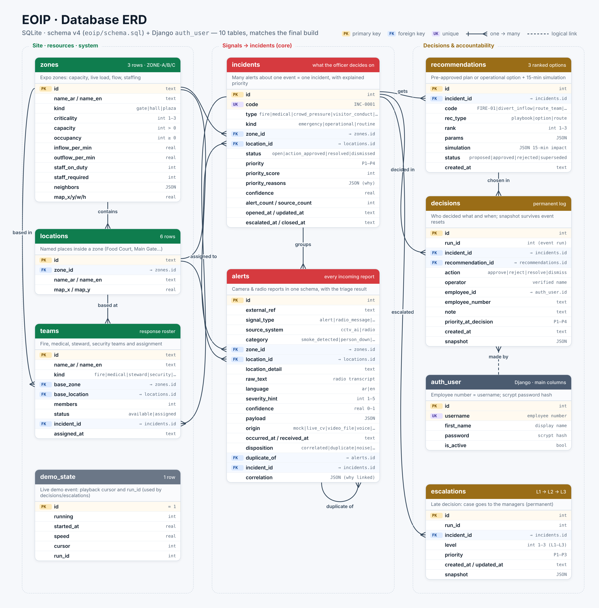
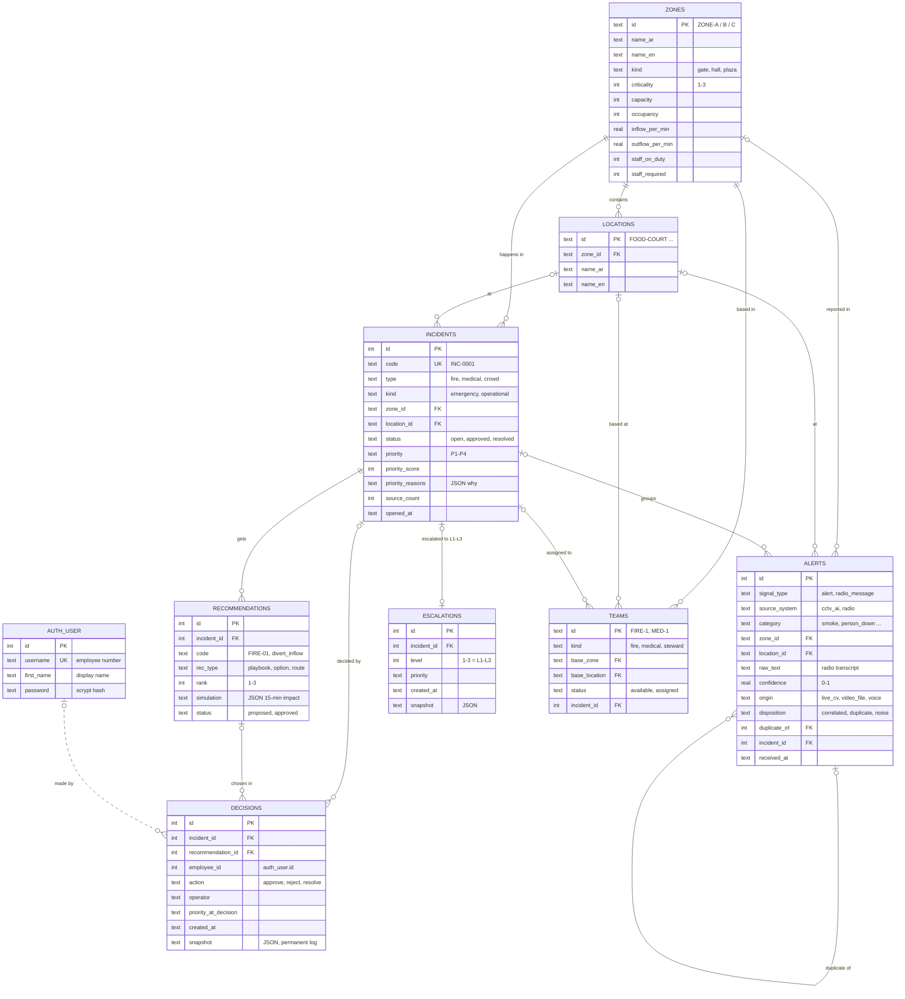

# مخطط قاعدة البيانات (ERD) · EOIP

قاعدة البيانات **SQLite** (وضع WAL)، والمخطط الكامل في [`eoip/schema.sql`](../eoip/schema.sql). حسابات الموظفين والجلسات من جداول Django الأساسية (`auth_user`, `django_session`).

الصورة أعلاه هي المخطط الكامل (كل أعمدة `schema.sql`، مطابق للنسخة النهائية). وهذه نسخة مختصرة بصيغة Mermaid يرسمها GitHub تلقائيًا:

## الجداول

| الجدول | الدور | أهم القيود |
|---|---|---|
| `zones` | مناطق المعرض (A/B/C): السعة، الإشغال الحالي، التدفق، الموظفون | `CHECK` على السعة والإشغال والأهمية (1–3) |
| `locations` | المواقع داخل كل منطقة (منطقة المطاعم، البوابة الرئيسية…) | `zone_id → zones` |
| `alerts` | **كل بلاغ وارد** من الكاميرا أو اللاسلكي بصيغة موحدة، مع نتيجة الفرز (`disposition`) وسبب الربط (`correlation`) | `CHECK` على النوع والمصدر والثقة (0–1)، `duplicate_of → alerts` (مكرر)، `incident_id → incidents` |
| `incidents` | **الحالة** التي يراها المسؤول: تجمع عدة بلاغات عن حدث واحد، مع الأولوية وسببها | `code` فريد، `CHECK` على الحالة والأولوية (P1–P4) |
| `recommendations` | خيارات القرار لكل حالة: خطة جاهزة أو خيار تشغيلي مع **محاكاة 15 دقيقة** | `incident_id → incidents`، `CHECK` على النوع والحالة |
| `decisions` | **سجل القرارات الدائم**: من قرّر، ماذا، متى، مع لقطة (`snapshot`) تبقى بعد إعادة التشغيل | `CHECK` على الإجراء، `employee_id` = رقم المستخدم في `auth_user` |
| `escalations` | التصعيد عند تأخر القرار: المستوى L1–L3 ووقت الوصول إليه (دائم) | `CHECK (level BETWEEN 1 AND 3)` |
| `teams` | فرق الاستجابة (إطفاء، طبي، تنظيم، أمن) وحالة التكليف | `base_zone → zones`، `incident_id → incidents` |
| `demo_state` | حالة الفعالية التجريبية (صف واحد) ورقم الجولة `run_id` | `CHECK (id = 1)` |
| `auth_user` | حسابات الموظفين (الرقم الوظيفي = اسم المستخدم)، كلمات مرور مشفرة scrypt | جدول Django |

## العلاقات

- منطقة واحدة ← عدة مواقع، وعدة حالات، وعدة بلاغات، وعدة فرق.
- **حالة واحدة ← عدة بلاغات** (هذا جوهر الحل: مئات البلاغات تصبح حالات قليلة).
- بلاغ ← قد يكون **مكررًا** لبلاغ سابق (علاقة ذاتية `duplicate_of`).
- حالة ← عدة توصيات، وعدة قرارات، وتصعيد واحد كحد أقصى.
- قرار ← مرتبط بتوصية (الخيار المعتمد) وبالموظف الذي اتخذه.

## الفهارس

`ix_alerts_dup (source_system, category, zone_id, received_at)` لكشف المكرر بسرعة · `ix_alerts_incident` · `ix_incidents_open (status, type, zone_id)` لإيجاد الحالة المفتوحة للربط · `ix_recs_incident` · `ix_decisions_incident` · `ix_escalations_incident`.
